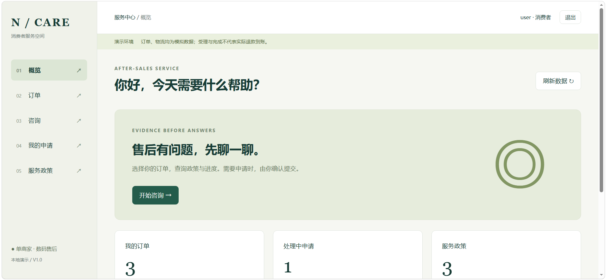
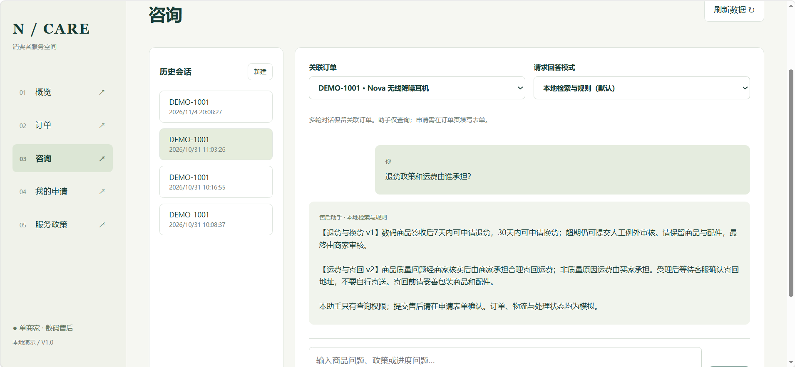

# E_commerce_AI_Agent — 单商家电商售后 Agent 平台

面向电商商家的数码商品售后演示平台，提供消费者服务入口和商家管理工作台。消费者可以查询本人订单、咨询售后政策、确认提交退换货申请并查看进度；商家负责人工审核、记录处理完成、维护政策版本和查看操作记录。

当前版本为 **V1 单商家本地演示版**，界面名称为 **N / CARE**。默认使用本地检索与规则回答，无需模型 API，也无需启动 PostgreSQL、Milvus 或 GPU 模型服务。

> 订单、物流和售后处理状态均为模拟数据。“已受理”和“处理完成”不代表实际退款到账。

## 界面预览

**消费者服务空间 · 概览**



**消费者服务空间 · 售后咨询**



## 功能

| 操作空间 | 功能 |
| --- | --- |
| 消费者 | 登录、概览、本人订单、订单关联咨询、退货/换货确认申请、我的申请、审核意见、服务政策、历史会话 |
| 商家 | 登录、概览、全部售后工单、规则预检、提交时政策快照、受理/拒绝、记录处理完成、政策编辑与版本历史、操作审计 |
| 售后助手 | 查询当前消费者订单和工单、检索商家政策、附带依据回答、多轮保留关联订单、可选模型回答与失败降级 |

助手只有查询权限。创建申请必须由消费者在表单中确认，审核和完成必须由商家操作；订单归属、角色权限、业务规则和状态流转均由后端代码控制。

## 业务流程

```text
消费者登录 → 查看并选择本人订单 → 咨询商品问题或售后政策
    → 在表单中确认退货/换货申请
    → 后端校验归属、幂等、重复申请和时间窗口
    → 创建 pending 工单，保存政策快照与规则预检
    → 商家填写意见，受理或拒绝
    → 消费者查看进度与处理意见
    → 商家对已受理工单记录处理完成
```

| 状态 | 含义 | 允许的下一状态 |
| --- | --- | --- |
| `pending` | 待人工审核 | `approved` / `rejected` |
| `approved` | 已受理，等待后续处理 | `completed` |
| `rejected` | 未通过 | 无 |
| `completed` | 处理完成（模拟记录） | 无 |

演示规则：**退货7天、换货30天**，从订单签收时刻起按连续24小时计算。超出窗口仍允许提交，标记为人工例外审核，不自动受理或拒绝。

政策管理目前只编辑正文。**正文修改不会自动改变代码中的7/30天规则**；调整时间规则时需要同步修改代码。工单保留提交时政策快照，后续编辑不改变历史依据。

## 技术架构

```text
Vue 3 + TypeScript + Vite
        │ /api/sales
FastAPI：登录会话、请求校验、角色与归属检查
        ├── 业务服务、规则预检、幂等申请、事务审核、状态机
        ├── LangGraph：intent → query → answer
        │       ├── 当前消费者订单/工单查询
        │       ├── 政策检索：FTS5 trigram + 关键词匹配
        │       └── 本地回答 / 可选 LLMFactory 模型回答
        └── SQLite：业务数据、政策版本、审计、对话与证据
```

| 层面 | 当前售后版本使用的组件 |
| --- | --- |
| 前端 | Vue 3、TypeScript、Vue Router、Vite |
| API | FastAPI、Pydantic、Uvicorn |
| Agent 编排 | LangGraph |
| 数据存储 | Python sqlite3、SQLite WAL、写事务 |
| 政策检索 | SQLite FTS5 trigram；不支持时回退至关键词匹配 |
| 默认回答 | 本地意图识别、查询与规则回答 |
| 可选模型 | 复用 `backend/core/llm_factory.py`，Agent 类型为 `after_sales` |
| 认证 | 随机令牌会话、数据库角色校验、PBKDF2-SHA256 密码哈希 |

## 项目结构

```text
E_commerce_AI_Agent/
├── backend/
│   ├── after_sales/
│   │   ├── main.py                 # 售后 API、认证、角色权限
│   │   ├── store.py                # SQLite、初始化、账号规范化、政策检索
│   │   ├── service.py              # 申请、规则预检、审核、状态流转
│   │   ├── agent.py                # LangGraph 查询与回答、模型降级
│   │   └── data/after_sales.sqlite3 # 首次启动创建的业务数据库
│   └── core/llm_factory.py         # 复用的统一模型工厂
├── frontend/
│   ├── src/views/AfterSalesView.vue
│   ├── src/views/after-sales.css
│   ├── src/api/sales.ts
│   └── src/router/index.ts         # 默认入口 /sales
├── docs/
│   ├── images/                     # 界面截图
│   ├── after-sales-guide.md
│   ├── after-sales-acceptance.md
│   └── plans/2026-10-31-after-sales.md
├── tests/test_after_sales.py
├── scripts/start-after-sales.ps1
├── scripts/start-after-sales-frontend.ps1
├── requirements-after-sales.txt
└── requirements-after-sales-llm.txt
```

原教育领域代码保留供对照，新售后服务不挂载教育 API。原项目的 PostgreSQL、Milvus、BGE-M3、Reranker 等组件不是当前售后版本的启动依赖，原教育能力也不代表已接入售后业务。

## 快速启动

当前项目目录：`W:\HeiMa class\Projects\E_commerce_AI_Agent`。

准备 Python 环境和 Node.js/npm。建议使用 Python 3.11 环境；以下命令中的 `python` 应指向安装了售后依赖的解释器。

### 1. 启动后端（8011）

在 PowerShell 中运行：

```powershell
Set-Location 'W:\HeiMa class\Projects\E_commerce_AI_Agent'
python -m pip install -r requirements-after-sales.txt
python -m uvicorn backend.after_sales.main:app --host 127.0.0.1 --port 8011
```

- API 文档：[http://127.0.0.1:8011/docs](http://127.0.0.1:8011/docs)
- 健康检查：[http://127.0.0.1:8011/api/sales/health](http://127.0.0.1:8011/api/sales/health)
- 健康检查应返回：`{"status":"ok","simulated":true,...}`

若系统的 `python` 是不可执行的 Windows 别名，请使用实际 Python 环境的完整路径。本机可使用 `edu_agent` 环境：

```powershell
& 'C:\Users\Naruto\.conda\envs\edu_agent\python.exe' -m uvicorn backend.after_sales.main:app --host 127.0.0.1 --port 8011
```

也可以在安装依赖后使用启动脚本：

```powershell
.\scripts\start-after-sales.ps1 -Python 'C:\Users\Naruto\.conda\envs\edu_agent\python.exe' -Port 8011
```

### 2. 启动前端（3000，代理到 8011）

另开一个终端：

```powershell
Set-Location 'W:\HeiMa class\Projects\E_commerce_AI_Agent\frontend'
npm ci
npm run dev
```

`frontend/vite.config.ts` 中的 `/api` 代理默认指向 `http://127.0.0.1:8011`，与上面的后端端口一致，**无需设置额外环境变量**。

打开终端输出的地址（通常是 [http://localhost:3000/sales](http://localhost:3000/sales)），根路径及其他未匹配路径也会跳转至 `/sales`。

注意事项：

- 若 3000 已被占用，Vite 会自动顺延到 3001、3002……，以终端输出的 `Local` 地址为准。
- 需要临时切换后端端口时，可在启动前设置 `SALES_API_TARGET`（只在启动时读取，修改后需重启）：
  - PowerShell：`$env:SALES_API_TARGET = 'http://127.0.0.1:8012'`
  - cmd：`set SALES_API_TARGET=http://127.0.0.1:8012`
- `npm run dev` 未指定 `--host`，默认监听 `localhost`（本机为 IPv6 `::1`）；`127.0.0.1:3000` 可能被其他项目的 Vite 占用。两个地址不是同一个服务。

### 3. 常见问题

**端口被占用**（启动后端时报 `[Errno 10048]`）：

```bash
netstat -ano | findstr :8011
tasklist /FI "PID eq <PID>"
taskkill /PID <PID> /F
```

确认该 PID 确实是旧的本项目进程后再结束；若是有意在另一个终端运行的实例，直接到那个终端按 `Ctrl+C`。

**登录页显示 Not Found**：说明前端代理到的后端没有 `/api/sales` 路由。常见原因：

1. 8011 上的后端没有启动，或启动的是旧版本；
2. 当前终端设置了 `SALES_API_TARGET`，指向了其他后端（例如 8000 上的旧版）。

先确认后端本身正常：

```powershell
Invoke-RestMethod http://127.0.0.1:8011/api/sales/health
```

应返回 `status = ok`。然后清除可能残留的环境变量并重启前端：

```powershell
Remove-Item Env:SALES_API_TARGET -ErrorAction SilentlyContinue
npm run dev
```

cmd 下清除变量用 `set SALES_API_TARGET=`。

**换端口**：同时修改后端 `--port` 和前端 `SALES_API_TARGET` 即可，例如后端 8012、前端 3013：

```powershell
# 后端终端，在项目根目录
python -m uvicorn backend.after_sales.main:app --host 127.0.0.1 --port 8012
```

```powershell
# 前端终端，在 frontend 目录（重启后生效）
$env:SALES_API_TARGET = 'http://127.0.0.1:8012'
npm run dev -- --port 3013
```

此时访问 [http://127.0.0.1:3013/sales](http://127.0.0.1:3013/sales)。

## 演示账号与操作

仅以下两个账号可以登录新售后平台，密码用于本地演示：

| 账号 | 密码 | 内部角色 | 空间 |
| --- | --- | --- | --- |
| `user` | `123456` | `customer` | 消费者服务空间 |
| `admin` | `123456` | `merchant` | 商家管理工作台 |

1. 使用 `user` 登录，在订单页查看模拟数码订单，选择订单进入咨询。
2. 询问“退货政策是什么？”“运费由谁承担？”，核对政策标题、版本和实际回答模式。
3. 回到订单页申请售后，选择退货或换货、填写原因并确认提交。
4. 使用 `admin` 登录，在工单审核页查看预检与政策快照，填写意见后受理或拒绝。
5. 使用 `user` 查看申请状态和意见，也可在关联订单会话中查询进度。
6. 商家将已受理工单记录为处理完成；在政策管理中维护版本，在操作记录中查看审计。

## Agent 回答模式

### 本地检索与规则回答（默认）

无需配置模型 API。通过本地关键词识别意图，查询本人订单或工单、检索当前政策后回答，并展示政策依据。证据不足时明确说明无法确定，不编造政策。

对话历史与关联订单保存到 SQLite。后续消息未提供 `order_id` 时沿用关联订单，显式传入 `null` 时清除关联。

### 大模型依据回答（可选）

```powershell
python -m pip install -r requirements-after-sales-llm.txt
```

模型通过 `LLMFactory.get_llm('after_sales')` 获取，复用统一工厂及 `.env.local` 配置。模型只负责基于已校验证据理解和表达，不拥有申请、审核或状态变更权限。

页面可切换请求模式。模型调用失败或超过8秒时，明确提示降级并返回本地结果；回答标签显示实际使用的模式。真实供应商调用尚未验证，已有验证使用模型替身及超时测试。

## 数据持久化与业务约束

- 默认业务库：`backend/after_sales/data/after_sales.sqlite3`。首次启动初始化模拟数据，重启不会重置已有业务记录。
- 可通过 `AFTER_SALES_DB` 环境变量指定数据库文件路径。迁移项目时应保留业务数据库；使用其他绝对路径时检查该变量是否仍指向旧位置。
- 保存用户、登录会话、订单、政策及版本、工单、操作审计、对话历史和回答证据。
- 登录令牌随机生成，数据库只保存令牌哈希，12小时过期，注销后失效；新入口不接受原教育 JWT。
- 消费者只能访问本人订单、工单和会话；商家接口由后端校验 `merchant` 角色。
- 申请使用用户范围内唯一的 `request_id` 保证幂等；相同内容重试返回同一工单，复用标识提交不同内容返回409。
- 同一订单最多存在一个待审核或已受理工单；已拒绝或已完成后可重新申请。
- 审核在写事务中检查当前状态，避免并发重复处理；政策编辑检查版本，过期版本返回409。
- 提交时保存政策快照，后续政策编辑不能改写旧申请的依据。
- 账号规范化保留内部用户 ID 和业务归属，停用其他账号；发生身份变化时撤销旧会话。数据库中可有无法登录的隔离测试数据所有者。

原教育数据库不会自动转换为售后订单；上述账号规范化针对本版售后数据库结构。

## 测试与构建

在项目根目录执行后端测试：

```powershell
python -m pytest tests/test_after_sales.py -q
```

前端类型检查与生产构建：

```powershell
cd frontend
npm run build
```

`npm run build` 包含 `vue-tsc` 和 Vite 构建，产物在 `frontend/dist`。生产托管需要配置前端路由回退和 `/api` 反向代理。

已有验收记录包含19项后端测试、前端类型检查与生产构建、浏览器申请与审核流程、政策快照、重启恢复及手机布局检查。**新目录已重新验证：19项后端测试通过，前端类型检查与生产构建通过；浏览器验证了消费者与商家登录、订单显示、政策咨询和历史工单读取。** 默认端口被占用时可使用8011/3011；测试临时目录权限的处理方法见[新目录启动检查](docs/after-sales-startup-check.md)。仅安装最小依赖时，可选模型工厂契约测试可能跳过。

## 当前边界

| 类别 | 说明 |
| --- | --- |
| 已实现 | 单商家售后闭环、查询 Agent、权限与归属校验、事务审核、政策版本、审计、SQLite 持久化 |
| 模拟能力 | 订单、物流、受理、处理完成；没有真实退款到账能力 |
| 未验证 | 真实模型供应商调用、新目录浏览器完整新建申请与审核流程、从零安装环境、生产部署与压力测试 |
| 未接入 | 真实订单/物流/退款接口、BGE-M3、Milvus、Reranker、持久化 LangGraph checkpointer |
| 后续计划 | 多商家隔离、附件/OCR、结构化政策规则、生产认证与安全运维 |

## 相关文档

- [售后操作指南](docs/after-sales-guide.md)
- [已有验收记录](docs/after-sales-acceptance.md)
- [新目录启动运行检查](docs/after-sales-startup-check.md)
- [迁移实施计划](docs/plans/2026-10-31-after-sales.md)

部分历史文档保留原目录和当时使用的端口，用于记录实施经过；当前目录与启动方式以本 README 为准。
